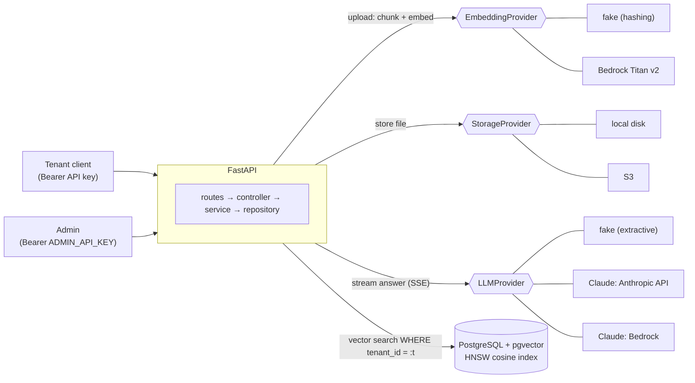
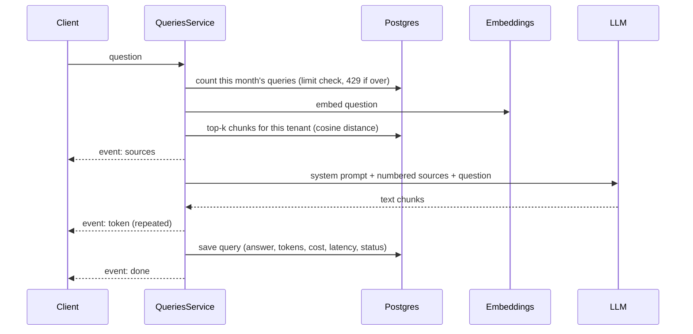
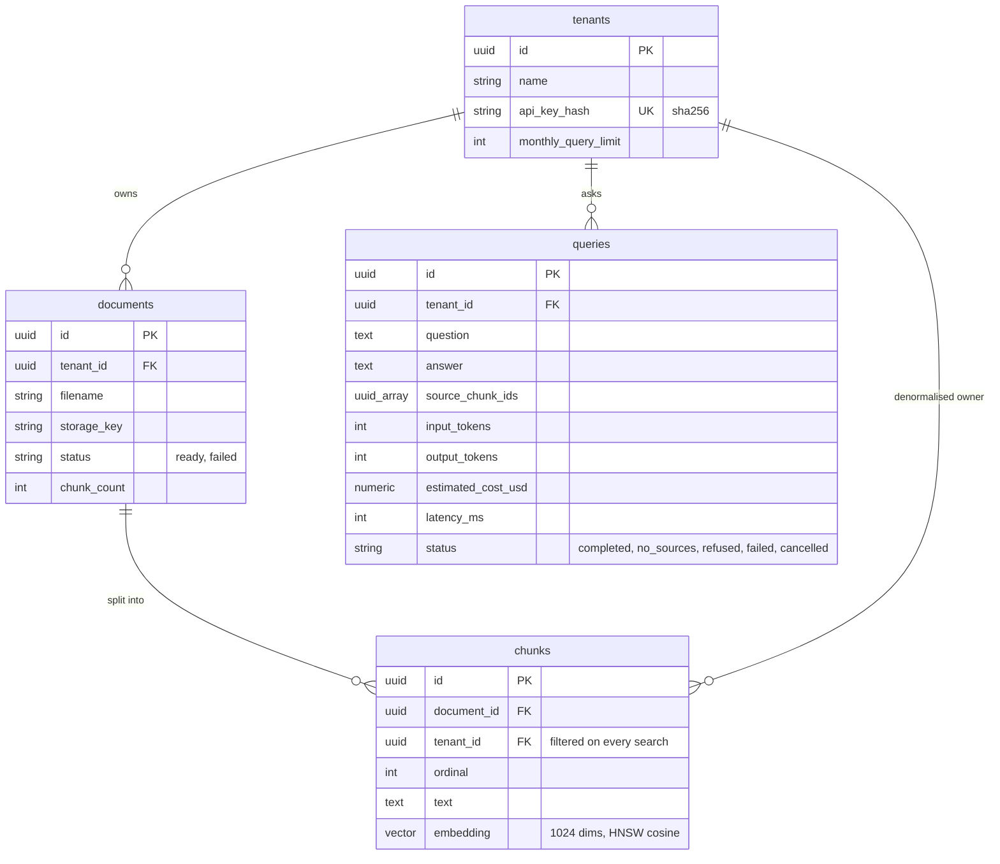

# rag-backend

A multi-tenant retrieval-augmented generation (RAG) API. Each tenant uploads its own documents. They're split into chunks, embedded, and stored in Postgres with pgvector. Questions retrieve **only that tenant's** most relevant chunks and stream back an answer with citations over Server-Sent Events. Every query records its token use and estimated cost, and each tenant has a monthly query limit.

**What runs where:** everything runs locally with Docker and no API keys. By default, embeddings and answers come from deterministic fake providers and files go to local disk. Claude (Anthropic API or Amazon Bedrock), Bedrock embeddings and S3 storage sit behind the same interfaces and are switched on by environment variables. They aren't exercised by the test suite. The project is **not deployed**.

**Stack:** Python 3.12, FastAPI, SQLAlchemy 2 (async) with asyncpg, Alembic, Pydantic v2, pgvector, the Anthropic Python SDK, boto3, pytest, ruff, uv.

## Architecture



How a question is answered (`POST /queries`):



```
app/
  core/        settings (validated at startup), errors + handlers, async engine + Database.transaction(),
               base repository, pagination, API-key auth, schema base (camelCase JSON)
  providers/   storage/ embeddings/ llm/: each has base.py (interface), implementations, factory.py
  modules/     tenants, documents, chunks (+ chunker.py), queries (+ prompt.py), usage
               each: routes.py → controller.py → service.py → repository.py, schemas.py, models.py
  container.py composition root          main.py  app factory
migrations/    Alembic (creates the vector extension, tables and the HNSW index)
scripts/       start_with_secrets.py (container entrypoint), eval.py
eval/          corpus/*.md (a small invented corpus), questions.jsonl
tests/         unit/ and integration/ (real Postgres with pgvector)
```

## Data model



Usage has no table of its own; it's aggregated from `queries`.

## Run it

Requires Docker.

```bash
cp .env.example .env
docker compose up --build
```

This starts Postgres with pgvector, runs migrations in a one-off container, then starts the API on <http://localhost:8000>. Interactive docs are at <http://localhost:8000/docs>. Postgres is exposed on host port **5443**; override it with `POSTGRES_HOST_PORT` and `API_HOST_PORT`.

```bash
ADMIN="Authorization: Bearer $(grep ADMIN_API_KEY .env | cut -d= -f2)"

# Create a tenant (its API key is shown once)
KEY=$(curl -s localhost:8000/admin/tenants -H "$ADMIN" -H 'Content-Type: application/json' \
  -d '{"name":"Acme"}' | jq -r .data.apiKey)

# Upload a document, then ask about it; -N shows the stream as it arrives
curl -s localhost:8000/documents -H "Authorization: Bearer $KEY" -F file=@eval/corpus/travel-policy.md
curl -N localhost:8000/queries -H "Authorization: Bearer $KEY" -H 'Content-Type: application/json' \
  -d '{"question":"How far in advance must flights be booked?"}'
```

To use Claude instead of the fake model, set `LLM_PROVIDER=anthropic` and `ANTHROPIC_API_KEY` in `.env`. For Bedrock, use `LLM_PROVIDER=bedrock`, `EMBEDDING_PROVIDER=bedrock` and `AWS_REGION` with AWS credentials. Then set `LLM_INPUT_USD_PER_MTOK` / `LLM_OUTPUT_USD_PER_MTOK` from your provider's current price list so cost estimates mean something.

### Tests and lint

```bash
docker compose up -d postgres     # tests use a separate rag_test database, created automatically
uv sync
uv run ruff check . && uv run ruff format --check .
uv run pytest
```

## Endpoints

Every JSON response uses one envelope: `{ "data": … }`, plus `"meta": { page, pageSize, total, totalPages }` on lists. Errors are `{ "error": { "code", "message", "details"? } }`. Lists take `?page=&pageSize=`. Bodies, query strings, path parameters and uploads are validated by Pydantic or the service.

| Method | Path | Auth | Notes |
|---|---|---|---|
| GET | `/health` | | |
| POST · GET | `/admin/tenants` | admin | POST returns the API key once |
| GET · PATCH · DELETE | `/admin/tenants/{id}` | admin | |
| POST | `/admin/tenants/{id}/rotate-key` | admin | Old key stops working at once |
| GET | `/admin/tenants/{id}/usage` | admin | `?month=YYYY-MM` |
| GET | `/tenant` | tenant | |
| POST · GET | `/documents` | tenant | Multipart upload of `.txt` / `.md`, max 2 MB by default |
| GET · DELETE | `/documents/{id}` | tenant | Delete also removes chunks and the stored file |
| GET | `/documents/{id}/chunks` · `/chunks/{id}` | tenant | |
| POST | `/queries` | tenant | `{question, topK?}`, answered as `text/event-stream` |
| GET | `/queries` · `/queries/{id}` | tenant | Answer, sources, tokens, cost, latency, status |
| GET | `/usage` | tenant | `?month=YYYY-MM`: queries, tokens, cost, limit, remaining |

**Stream events from `POST /queries`:**

| Event | Data |
|---|---|
| `sources` | `{queryId, sources: [{id, documentId, filename, ordinal, text, distance}]}` |
| `token` | `{text}` (repeated) |
| `error` | `{code, message}`, if the model call fails mid-stream |
| `done` | `{queryId, status, inputTokens, outputTokens, estimatedCostUsd, latencyMs}` |

## Key design decisions

**Tenant isolation inside the search query.** Every chunk row carries `tenant_id`, copied from its document, and `ChunkRepository.search` filters on it in the same SQL statement that ranks by cosine distance. However the ranking turns out, another tenant's chunks can't come back. A test gives two tenants near-identical documents and asks for `topK=20`: only the caller's own document ever appears.

**Errors before the stream, events during it.** The limit check, the question embedding and the vector search all run before the response starts, so their failures are ordinary JSON errors (429, 401, 400). Once streaming starts, a model failure becomes an `error` event, followed by `done` with status `failed`. The query row is saved in a `finally` block, shielded from cancellation, so a client that disconnects mid-answer should still leave a `cancelled` record with its partial answer. That disconnect path isn't covered by the tests; failures and refusals are.

**No sources, no model call.** If retrieval finds nothing, the API says so itself and records status `no_sources`. Paying for an answer that couldn't be grounded would be wasted money.

**Providers behind interfaces, chosen by factories.** `StorageProvider`, `EmbeddingProvider` and `LLMProvider` each have a local implementation (the default) and a cloud one, picked from settings in `providers/*/factory.py`. The fakes are useful rather than empty:
- Fake embeddings use the hashing trick, so texts sharing words really are closer.
- The fake LLM answers from source [1] with a citation, so tests can check the answer is grounded in the right source.

**Claude through the official SDK.** `ClaudeLLM` streams with `client.beta.messages.stream(...)` on `claude-opus-5-5`, with an explicit `effort` setting, and reads token usage from the final message. One class serves both the Anthropic API (`AsyncAnthropic`) and Bedrock (`AsyncAnthropicBedrockMantle`). If the model declines a request, it's re-run on a fallback model in the same call: on the Anthropic API through the server-side `fallbacks="default"` option, and on Bedrock (which doesn't support that) through the SDK's client-side `BetaRefusalFallbackMiddleware`. A refusal that survives the fallback is recorded as status `refused`.

**Cost is configuration, not code.** Estimated cost = tokens × `LLM_*_USD_PER_MTOK`. The prices default to 0, so the repository contains no hard-coded prices that could go stale.

**Paragraph-aware chunking with overlap** (`modules/chunks/chunker.py`). Paragraphs are packed up to `CHUNK_SIZE_CHARS`, long paragraphs are split on word boundaries, and each chunk starts with the tail of the previous one, so a sentence cut at a boundary still appears whole somewhere.

**Patterns, only where they earn their place.**
- *Singleton:* settings and the database engine (`lru_cache`).
- *Factory:* storage, embeddings and LLM providers.
- *Repository:* all data access, through `BaseRepository`.
- No Strategy: nothing varies by type.

## Results

Not yet measured, run `uv run python scripts/eval.py`.

(The script uploads `eval/corpus/` to a throwaway tenant, asks the 12 questions in `eval/questions.jsonl`, and prints hit@k, mean reciprocal rank, answer keyword recall, tokens and estimated cost. With the default fake providers it measures word-overlap retrieval and a placeholder answer, not a real model.)

## Known limitations

- **Uploads are processed inside the request.** Storing, chunking and embedding happen synchronously, which is fine for files up to the 2 MB limit; larger files would need a background queue.
- **Only plain text and Markdown.** No PDF or DOCX parsing.
- **Filtered HNSW search can return fewer than `topK` results.** pgvector applies the tenant filter after the approximate index scan, so a tenant with a small share of a very large table can get fewer results. pgvector's iterative index scans, or a partition per tenant, would address this.
- **The monthly limit can be exceeded under concurrency.** The limit is checked before the query and the row is written after it, so simultaneous queries can go slightly over.
- **Deleting a tenant leaves its stored files.** It removes the tenant's database rows (cascade) but not its files in storage.
- **The fake embeddings know nothing about meaning.** Synonyms don't match: "trip" won't find "travel".
- **The cloud providers aren't covered by tests.** Claude, Bedrock embeddings and S3 need real credentials.

## Deployment

| File | Purpose |
|---|---|
| `Dockerfile` | Multi-stage build with uv: installs locked production dependencies, then copies the virtualenv and source into a slim image that runs as a non-root user, with a healthcheck on `/health`. |
| `scripts/start_with_secrets.py` | Container entrypoint. With `SECRETS_SOURCE=aws` it loads one JSON secret (`SECRET_ID`) from AWS Secrets Manager into the environment; with `local` it uses `.env`. It fails fast if the secret or a required key (`DATABASE_URL`, `ADMIN_API_KEY`) is missing, validates settings, then starts uvicorn. |
| `deploy/ecs-task-definition.json` | ECS Fargate task definition template with `${…}` placeholders for account id, region, image tag, role ARNs, secret id, bucket and token prices. |
| `.github/workflows/deploy.yml` | Manual-only (`workflow_dispatch`) workflow. It assumes an AWS role through GitHub OIDC (no stored keys), builds and pushes the image to ECR, fills in the task definition and updates the ECS service. |
| `.github/workflows/ci.yml` | Runs ruff (lint and format check) and pytest against a pgvector Postgres service container on every push and pull request. |

Deployment config is provided as a reference. This project has not been deployed.
